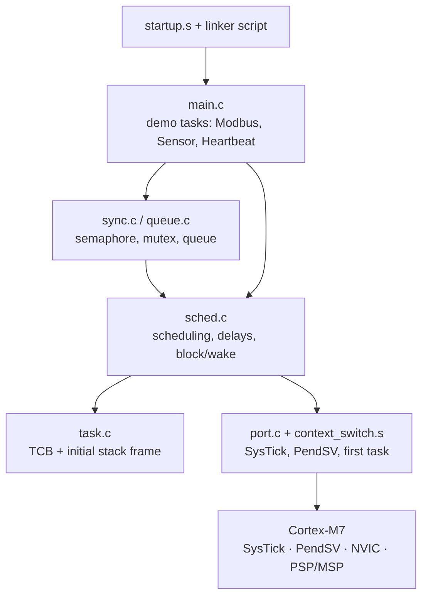
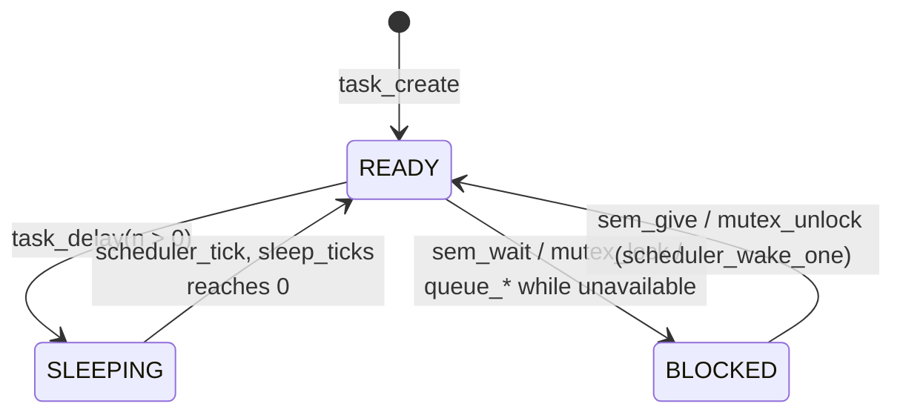
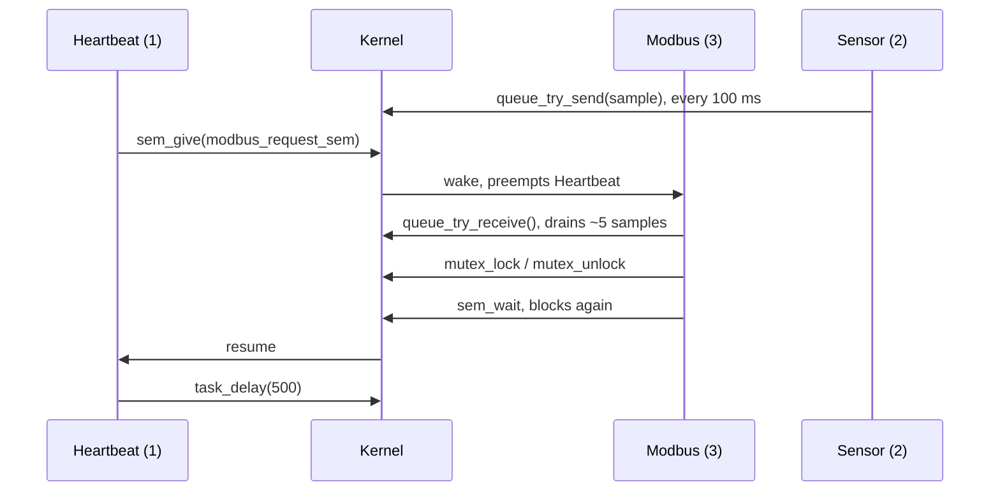

# RTOS – Technical Documentation

A small preemptive real-time kernel for the **STM32F756 (ARM Cortex-M7)**, developed and tested in the **Renode** simulator.
Written in C99 and ARM Thumb-2 assembly, about 600 lines of kernel code, no dynamic memory.

The chapters build on each other: hardware first, then the build and boot process, then the kernel bottom-up
(task → scheduler → port → context switch → synchronisation → queue), and finally the demo application.
Chapter 12 reviews the most important functions line by line, chapter 13 lists the known limitations.

## Contents

1. [Overview](#1-overview)
2. [Hardware background: Cortex-M7](#2-hardware-background-cortex-m7)
3. [Build system: `Makefile`](#3-build-system-makefile)
4. [Memory layout: `stm32f756.ld`](#4-memory-layout-stm32f756ld)
5. [Boot: `stm32f756_startup.s`](#5-boot-stm32f756_startups)
6. [Tasks: `task.h` / `task.c`](#6-tasks-taskh--taskc)
7. [Scheduler: `sched.h` / `sched.c`](#7-scheduler-schedh--schedc)
8. [Port layer: `port.h` / `port.c`](#8-port-layer-porth--portc)
9. [Context switch: `context_switch.s`](#9-context-switch-context_switchs)
10. [Synchronisation: `sync.h` / `sync.c`](#10-synchronisation-synch--syncc)
11. [Message queue: `queue.h` / `queue.c`](#11-message-queue-queueh--queuec)
12. [Application: `main.h` / `main.c`](#12-application-mainh--mainc)
13. [Simulation: Renode files](#13-simulation-renode-files)
14. [Review of the key functions](#14-review-of-the-key-functions)
15. [Known limitations and open issues](#15-known-limitations-and-open-issues)
16. [Comparison with FreeRTOS](#16-comparison-with-freertos)

---

## 1. Overview

### Features

| Feature | Implementation |
|---|---|
| Preemptive priority scheduling | Highest-priority READY task always runs |
| Round-robin between equal priorities | 1 ms time slices driven by SysTick |
| Sleeping | `task_delay(ticks)`, 1 kHz tick |
| Counting / binary semaphores | `semaphore_t`, usable from ISRs (`sem_give`) |
| Mutex with priority inheritance | `mutex_t`, owner-checked |
| Message queue | Fixed-size `uint32_t` ring buffer built from two semaphores |
| Idle task | Priority 0, sleeps the core with `WFI` |
| Static allocation | All TCBs, stacks and buffers are provided by the caller |

### Layers



Only `port.c` and `context_switch.s` are CPU-specific. Everything above them is portable C,
which is the same split that FreeRTOS uses (`tasks.c` vs. `portable/GCC/ARM_CM7/port.c`).

### File map

The repository is flat. The `Makefile` expects the files in the folder layout below.

| File | Expected folder | Role |
|---|---|---|
| `main.c`, `main.h` | `app/` | Demo application |
| `task.h`, `sched.h`, `sync.h`, `queue.h` | `kernel/inc/` | Kernel API |
| `task.c`, `sched.c`, `sync.c`, `queue.c` | `kernel/src/` | Kernel implementation |
| `port.c`, `port.h`, `context_switch.s` | `kernel/port/arm_cm7/` | CPU-specific part |
| `stm32f756_startup.s`, `stm32f756.ld` | `startup/` | Boot code, memory map |
| CMSIS headers, `system_stm32f7xx.c` | `hal/` (not committed) | `stm32f7xx.h`, `SystemCoreClock` |
| `Platform description template.txt`, `Startup script create.txt` | `renode/` | Simulator setup |

---

## 2. Hardware background: Cortex-M7

These are the CPU features the kernel is built on. Every later design decision refers back to them.

### 2.1 Modes and stack pointers

The Cortex-M has two modes and two stack pointers:

| | Uses | In this kernel |
|---|---|---|
| **Handler mode** | always MSP (Main Stack Pointer) | all interrupt handlers, incl. SysTick and PendSV |
| **Thread mode** | MSP or PSP (Process Stack Pointer), chosen by `CONTROL.SPSEL` | `main()` before the scheduler starts uses MSP; every task uses PSP |

Giving each task its own PSP stack and running all handlers on the single MSP stack is the standard RTOS layout.
An interrupt only pushes its 8-word frame onto the task's stack; any deeper nesting happens on the MSP.
So task stacks do not have to be sized for the worst-case interrupt nesting.

### 2.2 Exception entry and return

On interrupt entry the hardware automatically pushes 8 registers onto the active stack:

```
higher address   xPSR
                 PC        (return address)
                 LR
                 R12
                 R3
                 R2
                 R1
lower address    R0        <- SP after entry
```

These are exactly the **caller-saved** registers of the ARM calling convention (AAPCS).
A C function may use them freely, so interrupt handlers can be plain C functions.
The **callee-saved** registers R4–R11 are not stacked. A context switch must save them itself (chapter 9).

The hardware also loads a magic **EXC_RETURN** value into LR. Branching to it (`BX LR`) ends the exception.
Its bits select the mode and stack to return to:

| EXC_RETURN | Returns to | Stack | FP frame |
|---|---|---|---|
| `0xFFFFFFF1` | Handler mode | MSP | no |
| `0xFFFFFFF9` | Thread mode | MSP | no |
| `0xFFFFFFFD` | Thread mode | **PSP** | no |
| `0xFFFFFFED` | Thread mode | PSP | yes (FPU active) |

### 2.3 SysTick

A 24-bit down-counter built into every Cortex-M core. CMSIS `SysTick_Config(n)` makes it raise exception 15 every `n` clock cycles.
Being part of the core (not an STM32 peripheral) makes it the portable choice for the OS tick, which is why practically every Cortex-M RTOS uses it.

### 2.4 PendSV

*Pendable Service Call*, exception 14. It is triggered only by software, by writing `PENDSVSET` in `SCB->ICSR`.
It stays pending until no higher-priority exception is active.
If it has the lowest priority, it runs only **after every other interrupt has finished**, by tail-chaining onto the last one.

This makes PendSV the standard place to switch contexts (FreeRTOS, CMSIS-RTX, µC/OS-III):

- Any code (a task, SysTick, a UART ISR) can *request* a switch just by pending PendSV.
- The switch itself never happens in the middle of another ISR. Switching there would return the interrupted ISR into the wrong task.

### 2.5 NVIC priorities

The STM32F7 implements 4 priority bits: levels 0 (highest) to 15 (lowest).

- Exceptions at the **same** priority level never preempt each other.
- If several exceptions with the same priority are pending, the one with the **lower exception number** runs first. PendSV (14) therefore goes before SysTick (15).

### 2.6 PRIMASK and critical sections

`__disable_irq()` (`CPSID I`) sets PRIMASK and blocks every interrupt except NMI and HardFault.
`__enable_irq()` (`CPSIE I`) clears it. The kernel uses this pair for all of its critical sections.
It is the simplest correct choice on a single-core MCU.
FreeRTOS uses `BASEPRI` instead, so that very high-priority ISRs that never call the kernel are not delayed.

### 2.7 Stack alignment

AAPCS requires the stack to be **8-byte aligned** at public function boundaries.
Code that uses `double`, `int64_t` or `LDRD/STRD` can misbehave if it is not.
All stacks in the kernel are declared with `__attribute__((aligned(8)))`.

---

## 3. Build system: `Makefile`

Builds a single bare-metal ELF (`build/rtos_sim.elf`) with the GNU Arm toolchain (`arm-none-eabi-`).

| Flag | Why |
|---|---|
| `-mcpu=cortex-m7 -mthumb` | Cortex-M executes only the Thumb instruction set |
| `-DSTM32F756xx` | Selects the right device in the CMSIS header `stm32f7xx.h` |
| `-O0 -g3` | No optimisation and full debug info. Makes stepping through the scheduler and the stacks readable. |
| `-Wall` | All common warnings |
| `-ffunction-sections -fdata-sections` + `-Wl,--gc-sections` | Every function/variable gets its own section, and the linker drops unused ones. Standard size optimisation for MCUs. |
| `-nostdlib` | No C runtime startup (`crt0`) and no libc. The kernel provides its own startup and uses only `<stdint.h>`/`<stddef.h>`. |
| `-T stm32f756.ld` | Custom memory map (chapter 4) |
| `-Wl,-Map=...,--cref` | Map file with a cross-reference table, useful to check where every symbol ended up |
| no `-mfloat-abi` | Defaults to **soft-float**: the FPU is never used, so the context switch does not need to save FPU registers |

Object files from all folders are collected into `build/` with `vpath`, then linked, and `arm-none-eabi-size` prints the memory usage.

**Open issues** (see chapter 15): `ASM_SOURCES` is defined twice (the second definition, with lowercase `.s`, wins), there is no rule for `.S` files,
and the CMSIS headers and `system_stm32f7xx.c` are not in the repository.

---

## 4. Memory layout: `stm32f756.ld`

### Memory regions

| Region | Address | Size | Content |
|---|---|---|---|
| FLASH | `0x08000000` | 1 MB | vector table, code, constants, initial values of `.data` |
| RAM | `0x20000000` | 320 KB | `.data`, `.bss`, main stack |

The 320 KB covers the STM32F756's DTCM (64 KB), SRAM1 (240 KB) and SRAM2 (16 KB), which are contiguous in the address map.

### Sections

| Section | Placed in | Notes |
|---|---|---|
| `.isr_vector` | start of FLASH | `KEEP()` because no code references it, so `--gc-sections` would delete it. After reset the core reads the vector table from address 0, which is aliased to the start of flash. |
| `.text` | FLASH | code and `.rodata` |
| `.data` | runs in RAM, stored in FLASH (`>RAM AT> FLASH`) | `_la_data` = load address in flash; `_sdata`/`_edata` = RAM range. The startup code copies it. |
| `.bss` | RAM | `_sbss`/`_ebss`; zeroed by the startup code. All task stacks and TCBs live here. |

`_estack = ORIGIN(RAM) + LENGTH(RAM)` = `0x20050000`, the **end** of RAM.
Cortex-M stacks are *full-descending* (they grow down), so the main stack starts at the top.

**Design choice:** there is no heap section. All kernel objects are allocated statically, so memory usage is known at link time and there is no fragmentation.
This is the usual approach in safety-oriented embedded code (MISRA C, FreeRTOS `configSUPPORT_STATIC_ALLOCATION`).

---

## 5. Boot: `stm32f756_startup.s`

### `Reset_Handler`

The first code that runs after power-on:

1. **Set SP to `_estack`.** The hardware already loads SP from vector 0, but setting it again makes the code safe to enter from a debugger or bootloader.
2. **Copy `.data`** from flash to RAM word by word. This gives initialised globals their start values.
3. **Zero `.bss`.** C requires uninitialised globals to start at zero. The kernel relies on this, e.g. `current_task` must be `NULL` before the scheduler starts.
4. **`bl main`**, then trap in an endless loop if `main` ever returns.

The loops use Thumb-2 `IT` blocks (`ittt lt`), which make up to four following instructions conditional without branches.

What the startup deliberately **does not** do:

| Not done | Why it's fine here |
|---|---|
| `SystemInit()` / clock setup | The core runs on the 16 MHz internal HSI after reset, which matches the CMSIS default `SystemCoreClock = 16000000` |
| Enable the FPU | The build is soft-float |
| `__libc_init_array()` | Only needed for C++ constructors and libc, neither is used |

### Vector table `g_pfnVectors`

Contains only the 16 Cortex-M system entries: stack top, Reset, NMI, HardFault, SVC, PendSV and SysTick.
Every handler is declared as a **weak alias** of `Default_Handler` (an endless loop).
A strong definition elsewhere replaces the alias at link time, so the kernel overrides `PendSV_Handler` (in `context_switch.s`) and `SysTick_Handler` (in `port.c`) without touching this file.
This is the same mechanism the vendor (ST/CMSIS) startup files use.

---

## 6. Tasks: `task.h` / `task.c`

### The Task Control Block

```c
typedef struct tcb {
    uint32_t *sp;            /* MUST stay at offset 0 */
    struct tcb *next;
    task_status_t status;
    uint32_t sleep_ticks;
    void *waiting_obj;
    uint8_t id;
    uint8_t priority;
    uint8_t base_priority;
} TCB_t;
```

| Field | Purpose | Design choice |
|---|---|---|
| `sp` | Saved stack pointer of a switched-out task | At offset 0 so the assembly can reach it with a plain `LDR R1, [R0]` and needs no offset constants. FreeRTOS does the same (`pxTopOfStack` is the first TCB member). |
| `next` | Next TCB in a circular list | An *intrusive* list: the link lives in the TCB itself, so adding a task needs no allocation |
| `status` | `READY`, `BLOCKED` or `SLEEPING` | The running task stays `READY` ("runnable"). `TASK_RUNNING` exists in the enum but is unused. `current_task` already says who runs. |
| `sleep_ticks` | Remaining ticks while sleeping | Relative countdown, decremented every tick |
| `waiting_obj` | Address of the semaphore/mutex the task waits on | Replaces per-object wait lists (chapter 7) |
| `priority` | Effective priority, higher = more important | Can be raised temporarily by priority inheritance |
| `base_priority` | Priority given at creation | Restored when the mutex is released |

### Task states



### `task_create()`

Prepares a stack that looks exactly as if the task had **already been running and was just switched out**:

| Offset from new `sp` | Value | Pushed by (normally) |
|---|---|---|
| +0 … +7 words | R4 … R11 (`0x04040404` … `0x11111111`) | PendSV, software |
| +8 | R0 = 0 | hardware |
| +9 … +11 | R1, R2, R3 | hardware |
| +12 | R12 | hardware |
| +13 | LR = `task_exit_handler` | hardware |
| +14 | PC = `task_func` | hardware |
| +15 | xPSR = `0x01000000` | hardware |

Design choices:

- **Fake frame.** Starting a task uses exactly the same code path as resuming one: PendSV restores R4–R11, the exception return restores the rest and jumps to `PC`. No special "first run" code is needed. FreeRTOS's `pxPortInitialiseStack()` works the same way.
- **xPSR = `0x01000000`** sets the Thumb bit (T). Cortex-M can only execute Thumb code. Returning with T = 0 causes an INVSTATE UsageFault.
- **LR = `task_exit_handler`.** If a task function ever returns, it lands in a known trap instead of a random address.
- **Register patterns** like `0x05050505` make every register easy to recognise in a memory dump while debugging.
- **Alignment.** 16 words = 64 bytes are pushed, so an 8-byte-aligned stack top stays aligned.

### `task_exit_handler()`

Disables interrupts and spins forever. A task returning from its function is treated as a programming error, and the system stops in a visible state.
This is a deliberate *fail-stop* design, and FreeRTOS's `prvTaskExitError()` does the same.
The alternative would be to mark the task as terminated and keep the other tasks running.

---

## 7. Scheduler: `sched.h` / `sched.c`

### Global state

```c
TCB_t *current_task;   /* task whose context is on the CPU     */
TCB_t *next_task;      /* task that should run after next PendSV */
```

**Design choice:** C decides, assembly executes. `schedule()` writes its decision into `next_task`, and PendSV only copies registers.
This keeps the assembly minimal. FreeRTOS instead calls `vTaskSwitchContext()` *inside* PendSV, which keeps the decision and the switch atomic (see chapter 15).

### The idle task

`idle_tcb` (priority 0, 64-word stack) runs `scheduler_idle()`, which loops on `__WFI()`.

- The scheduler always has something to run, so `schedule()` never has to handle "no task".
- `WFI` (*Wait For Interrupt*) stops the core clock until the next interrupt, which saves power while all tasks wait. FreeRTOS's idle task plus tickless idle is the more advanced version of this.
- The idle TCB is also the **anchor** of the circular task list: every loop over all tasks starts and ends at `&idle_tcb`.

### `scheduler_init()`

Disables interrupts (they stay off until the first task starts), creates the idle task and makes it a one-element circular list.

### `scheduler_add_task()`

Creates the task and inserts it right after the idle task. Insertion at the head is O(1); the list order is the reverse of the creation order.

### `scheduler_start()`

Runs `schedule()` once to choose the first task, then hands over to `port_start_first_task()`, which never returns.

### `schedule()` – choosing the next task

Walks the circular list exactly once, **starting at `current_task->next`**, and keeps the READY task with the highest priority.
A candidate replaces the best one only if its priority is **strictly greater**.

The consequences:

- **Priority preemption.** A higher-priority READY task always wins.
- **Round-robin.** Among equal priorities, the first one found after `current_task` wins. The current task is visited last, so it keeps the CPU only if no equal-priority peer is ready. Since SysTick calls `schedule()` every 1 ms, equal-priority tasks get **1 ms time slices**, like FreeRTOS with `configUSE_TIME_SLICING`.
- **Idle only as fallback.** The idle task is skipped in the search and chosen only when nothing else is READY.

Complexity is O(N) in the number of tasks. FreeRTOS keeps one ready list per priority plus a bitmap and finds the highest priority with the Cortex-M `CLZ` instruction in O(1).
For the three tasks here, the linear scan takes only a few cycles and is easier to verify.

### `scheduler_tick()` – time management

Called from SysTick once per tick. It decrements `sleep_ticks` for every `SLEEPING` task and makes it `READY` at 0.
It is O(N) per tick. FreeRTOS stores absolute wake-up times in a sorted delayed list and checks only its head.

As in any tick-based OS, `task_delay(n)` sleeps between **n−1 and n** tick periods, depending on where in the current tick it is called.

### `task_delay(ticks)`

```
disable IRQs → mark SLEEPING → schedule() → pend PendSV → enable IRQs
```

PendSV is pended inside the critical section and fires as soon as `__enable_irq()` runs, so the task is switched out at that point.
`task_delay(0)` does not sleep. It only reschedules, which acts as a **yield** to an equal- or higher-priority READY task.

### Blocking helpers (used by `sync.c` and `queue.c`)

All three must be called with interrupts disabled.

| Function | Does |
|---|---|
| `scheduler_block_current(obj)` | `current_task` → `BLOCKED`, `waiting_obj = obj` |
| `scheduler_wake_one(obj)` | Finds the **highest-priority** task blocked on `obj` and makes it READY |
| `scheduler_reschedule()` | `schedule()`, and pends PendSV only if `next_task` changed. Does nothing before the scheduler has started. |

**Design choice – `waiting_obj` instead of wait lists.** RTOSes usually give each semaphore its own list of waiting tasks (FreeRTOS: `xTasksWaitingToReceive`).
Here a blocked task just stores the address of the object it waits for, and waking means scanning all tasks for a match.

- Semaphores and mutexes need no extra memory or list handling.
- Waking the highest-priority waiter first (not FIFO) matches FreeRTOS, whose wait lists are sorted by priority.
- The cost is an O(N) scan per wake-up, which is negligible for a handful of tasks.

---

## 8. Port layer: `port.h` / `port.c`

### `port_yield()`

Sets `PENDSVSET` in `SCB->ICSR` and returns. The switch happens once PendSV can run: immediately if interrupts are enabled, otherwise right after the next `__enable_irq()`.

### `port_start_first_task(first)`

1. `next_task = first`.
2. `__set_CONTROL(0)`, then `__ISB()`. Thread mode stays **privileged** on MSP for now. The architecture requires an `ISB` after writing `CONTROL` so later instructions see the change.
3. Pend PendSV, then enable interrupts.

At this point both PendSV and possibly SysTick are pending. Both have priority 15, so the lower exception number goes first: **PendSV runs before the first tick**.
Since `current_task` is still `NULL`, PendSV skips the save step, restores the first task and returns with `0xFFFFFFFD`.
That return switches thread mode from MSP to **PSP**, so from now on every task runs on its own stack.

**Design notes:**

- Tasks run privileged. There is no MPU-based separation between tasks, which is the usual default for small kernels (FreeRTOS only adds it in the MPU port).
- The frames of `main()` stay on the MSP and are never reclaimed. FreeRTOS resets MSP to the vector table value and starts the first task through `SVC`, which wins back those few bytes.

### `SysTick_Handler()`

```c
if(current_task == NULL) return;      /* scheduler not started */
scheduler_tick();                     /* wake expired sleepers */
schedule();                           /* pick next task        */
if(next_task != current_task) port_yield();
```

PendSV is only pended when a switch is actually needed, which saves an empty context switch every millisecond.
SysTick and PendSV share the lowest priority, so a tick can never run in the middle of a context switch and change `next_task` there.

---

## 9. Context switch: `context_switch.s`

```asm
PendSV_Handler:
    LDR R0, =current_task
    LDR R0, [R0]          ; R0 = current_task
    CBZ R0, restore       ; first switch: nothing to save

    MRS R1, PSP           ; task stack, hardware frame already pushed
    STMDB R1!, {R4-R11}   ; push the callee-saved registers
    STR R1, [R0]          ; current_task->sp = R1

restore:
    LDR R0, =next_task
    LDR R0, [R0]          ; R0 = next_task
    LDR R1, [R0]          ; R1 = next_task->sp
    LDMIA R1!, {R4-R11}   ; pop its callee-saved registers
    MSR PSP, R1           ; PSP now points at its hardware frame

    LDR R0, =current_task
    LDR R2, =next_task
    LDR R2, [R2]
    STR R2, [R0]          ; current_task = next_task

    LDR LR, =0XFFFFFFFD   ; thread mode, PSP, no FP frame
    BX LR                 ; hardware pops R0-R3, R12, LR, PC, xPSR
```

How it works:

1. On entry the hardware has already pushed R0–R3, R12, LR, PC and xPSR of the old task onto its PSP stack (section 2.2).
2. `STMDB` (*store multiple, decrement before*) pushes R4–R11 below that, in the same full-descending order as the hardware. The resulting `sp` is saved into the TCB.
3. `LDMIA` (*load multiple, increment after*) does the reverse for the new task. Afterwards `R1` points at its hardware frame, which becomes the new PSP.
4. The exception return pops the rest. The new task continues exactly where it stopped, or starts at `task_func` if it is new (section 6).

**Design choices:**

- **Only R4–R11 in software.** Everything else is saved by the hardware, so the switch is 8 stores and 8 loads plus pointer handling.
- **`CBZ` for the first run.** No separate start routine is needed. The first task is "restored" like any other.
- **Fixed EXC_RETURN `0xFFFFFFFD`.** All tasks run on PSP and no FPU frame ever exists (soft-float). A kernel with an FPU must save EXC_RETURN per task and conditionally save S16–S31, which is what FreeRTOS's CM7 port does.
- **`.thumb_func`** marks the label as Thumb code, so its address in the vector table has bit 0 set as the core requires.
- **R0–R3 as scratch.** Their task values are already safe in the hardware frame.

---

## 10. Synchronisation: `sync.h` / `sync.c`

### The blocking pattern

Every blocking function follows this structure:

```c
__disable_irq();
while(resource not available){
    scheduler_block_current(obj);  /* status = BLOCKED, waiting_obj = obj */
    scheduler_reschedule();        /* choose someone else, pend PendSV    */
    __enable_irq();                /* PendSV runs HERE: we are switched out */
    __disable_irq();               /* ...we continue here after waking up  */
}
take resource;
__enable_irq();
```

- **The enable/disable pair** is the window where the pending PendSV switches the task out. When the task runs again, it continues right after `__enable_irq()`.
- **`while`, not `if`.** Being woken only means "the resource *may* be free". A higher-priority task can take it before the woken task actually runs, so it must check again. This is the same rule as for POSIX condition variables (*Mesa semantics*).
- **Robust against a late PendSV.** If PendSV did not fire in that window, the loop simply marks the task blocked again and retries, so nothing breaks.

### Semaphore

```c
typedef struct { uint32_t count; uint32_t max_count; } semaphore_t;
```

| Function | Behaviour | Context |
|---|---|---|
| `sem_init(sem, initial, max)` | Sets the count and upper limit | any |
| `sem_wait()` | Takes a token, blocks while `count == 0` | task only |
| `sem_try_wait()` | Takes a token or returns −1 | task or ISR |
| `sem_give()` | Adds a token, wakes the highest-priority waiter and reschedules. Returns −1 at `max_count`. | task or ISR |

Design choices:

- **`max_count`.** One type covers counting semaphores and binary semaphores (`max = 1`). A binary semaphore works as an event flag: extra gives while it is already 1 are dropped, which is right for "a Modbus frame has arrived".
- **Immediate preemption in `sem_give`.** If the woken task has a higher priority, the giver is switched out at once. FreeRTOS does the same with `portYIELD_WITHIN_API()`.
- **Same function from an ISR.** In an ISR, `sem_give` only pends PendSV. PendSV has the lowest priority, so the switch is automatically deferred until the ISR has finished, and the woken task then runs directly after it. This is the standard **deferred interrupt processing** pattern: the ISR does the minimum and a task does the work. FreeRTOS needs a separate `xSemaphoreGiveFromISR()` plus `portYIELD_FROM_ISR()` for this.

### Mutex

```c
typedef struct { uint8_t locked; TCB_t *owner; } mutex_t;
```

A mutex is a binary semaphore with an **owner**. The owner makes two things possible:

1. **Ownership check.** `mutex_unlock()` returns −1 if the caller is not the owner.
2. **Priority inheritance.** If a task blocks on a mutex held by a lower-priority task, the owner is temporarily raised to the waiter's priority.

Priority inheritance prevents *unbounded priority inversion*: low holds the mutex, high waits for it, and a medium task keeps low off the CPU indefinitely.
It is the problem that reset the Mars Pathfinder lander in 1997.
In the demo, Modbus (3) and Sensor (2) share `sensor_data_mutex`; inheritance guarantees that no task with a priority between theirs could delay Modbus while Sensor holds it.

`mutex_unlock()` sets `priority = base_priority` and wakes the highest-priority waiter.
Restoring the base priority directly is correct as long as a task holds only one mutex at a time.

Mutexes are task-only: an ISR has no task identity to be the owner.

---

## 11. Message queue: `queue.h` / `queue.c`

```c
typedef struct {
    uint32_t *buffer;  uint32_t capacity;
    uint32_t head, tail;
    semaphore_t items;   /* filled slots, receivers wait here */
    semaphore_t spaces;  /* free slots,   senders wait here   */
} queue_t;
```

The queue is the classic **bounded buffer** (Dijkstra's producer–consumer solution) built from two counting semaphores:

```
send:     wait(spaces) → write at tail → give(items)
receive:  wait(items)  → read at head  → give(spaces)
```

Design choices:

- **No new blocking code.** All waiting and waking comes from the semaphores. Senders wait on `&q->spaces`, receivers on `&q->items`, so the two groups never wake each other by mistake.
- **`uint32_t` items, copied by value.** Fixed-size messages keep the code simple. Larger data is sent as a pointer or an index. FreeRTOS copies an arbitrary `uxItemSize` instead.
- **Caller-supplied buffer.** Static allocation, like the rest of the kernel.
- **Ring buffer with `%`.** The Cortex-M7 has a hardware divider (`UDIV`, a few cycles), so the modulo is cheap. Power-of-two sizes with a bit mask would be the faster alternative.
- **Short critical section in `queue_put`/`queue_get`.** The semaphore only reserves a slot. With several senders, two tasks could hold a reservation at the same time and race on `tail`, so the index update itself must be atomic.
- **`queue_try_send`/`queue_try_receive`** never block and are ISR-safe, for example to push received UART bytes from an interrupt.

---

## 12. Application: `main.h` / `main.c`

A Modbus sensor node skeleton: three tasks that exercise every kernel feature.

| Task | Priority | Period | Role |
|---|---|---|---|
| `modbus_task` | 3 (high) | event-driven | Waits for a request, drains the queue, reads the shared data under the mutex |
| `sensor_task` | 2 (medium) | 100 ms | Produces a (fake) sample, updates the shared struct, pushes into the queue |
| `heartbeat_task` | 1 (low) | 500 ms | Toggles the LED state, simulates a Modbus request with `sem_give` |
| idle | 0 | – | `WFI` |

**Why these priorities.** A Modbus slave must answer within a response timeout, so the event-driven communication task gets the highest priority.
The periodic sensor task comes next, and the heartbeat is the least time-critical.
This follows the usual rule of giving tighter deadlines higher priorities (the idea behind *rate-monotonic* scheduling).

| Kernel object | Type | Used for |
|---|---|---|
| `modbus_request_sem` | binary semaphore (0, max 1) | "request arrived" event. Later given by the UART ISR. |
| `sensor_data_mutex` | mutex | protects `sensor_data` |
| `sensor_queue` | queue, 8 items | temperature samples from Sensor to Modbus |

### One heartbeat cycle



### `main()`

1. `scheduler_init()` – interrupts off, idle task created.
2. Initialise the semaphore, mutex and queue.
3. Add the three tasks with 256-word (1 KB) stacks.
4. Set PendSV and SysTick to the **same, lowest** NVIC priority (15) so they can never preempt each other (sections 2.5 and 8).
5. `SysTick_Config(SystemCoreClock / 1000)` for a 1 kHz tick: 1 ms resolution with low overhead, the common default (FreeRTOS `configTICK_RATE_HZ = 1000`).
6. `scheduler_start()` – never returns.

The debug counters are `volatile`, so the compiler cannot optimise them away, and they can be watched live in Renode or a debugger.

---

## 13. Simulation: Renode files

**`Platform description template.txt`** (a Renode `.repl` file) describes the virtual board:
a Cortex-M7 with its NVIC, 1 MB flash at `0x08000000`, 320 KB SRAM at `0x20000000`, USART3 at `0x40004800` (IRQ 39) and an Ethernet MAC (IRQ 61).
USART3 is the UART that is connected to the ST-LINK virtual COM port on NUCLEO-F756ZG boards, which makes it the natural choice for Modbus RTU.

**`Startup script create.txt`** (a Renode `.resc` script) creates the machine, loads the platform description, opens a UART analyser, loads the ELF and starts the simulation.

The NVIC entry has no `systickFrequency` set, so simulated ticks do not match real milliseconds. Setting it to the core clock (16 MHz) makes the timing realistic.

---

## 14. Review of the key functions

### `schedule()` – `sched.c`

```c
void schedule(){
    TCB_t *start = (current_task != NULL) ? current_task->next : idle_tcb.next;
    TCB_t *candidate = start;
    TCB_t *best = NULL;

    do {
        if(candidate != &idle_tcb && candidate->status == TASK_READY){
            if(best == NULL || candidate->priority > best->priority){
                best = candidate;
            }
        }
        candidate = candidate->next;
    } while(candidate != start);

    next_task = (best != NULL) ? best : &idle_tcb;
}
```

Preemption, round-robin and the idle fallback in 15 lines. Starting at `current_task->next` with a strict `>` is what produces the round-robin.
Correct for any number of tasks; the cost grows linearly.

### `PendSV_Handler` – `context_switch.s`

Shown in full in chapter 9. 17 instructions; saves only what the hardware does not, and handles the first task through the same path.
Its correctness depends on `next_task` not changing while it runs (chapter 15).

### `SysTick_Handler()` – `port.c`

```c
void SysTick_Handler(void){
    if(current_task == NULL) return;
    scheduler_tick();
    schedule();
    if(next_task != current_task){
        port_yield();
    }
}
```

Wakes sleepers, reschedules, and pends a switch only when needed. The `NULL` guard makes an early tick harmless.

### `task_delay()` – `sched.c`

```c
void task_delay(uint32_t ticks){
    __disable_irq();
    if(ticks > 0){
        current_task->sleep_ticks = ticks;
        current_task->status = TASK_SLEEPING;
    }
    schedule();
    port_yield();
    __enable_irq();
}
```

The state change and the scheduling decision happen atomically. The switch happens at `__enable_irq()`.
`port_yield()` is called unconditionally, so `task_delay(0)` without any other ready task causes one harmless PendSV that switches back to the same task.

### `sem_wait()` / `sem_give()` – `sync.c`

```c
void sem_wait(semaphore_t *sem){
    __disable_irq();
    while(sem->count == 0){
        scheduler_block_current(sem);
        scheduler_reschedule();
        __enable_irq();
        __disable_irq();
    }
    sem->count--;
    __enable_irq();
}

int sem_give(semaphore_t *sem){
    int result = -1;
    __disable_irq();
    if(sem->count < sem->max_count){
        sem->count++;
        scheduler_wake_one(sem);
        scheduler_reschedule();
        result = 0;
    }
    __enable_irq();
    return result;
}
```

The `while` loop makes the wait safe against stolen wake-ups. `sem_give` works from tasks and ISRs because the switch always goes through PendSV.

### `mutex_lock()` / `mutex_unlock()` – `sync.c`

```c
void mutex_lock(mutex_t *mtx){
    __disable_irq();
    while(mtx->locked){
        if(mtx->owner->priority < current_task->priority){
            mtx->owner->priority = current_task->priority;   /* inheritance */
        }
        scheduler_block_current(mtx);
        scheduler_reschedule();
        __enable_irq();
        __disable_irq();
    }
    mtx->locked = 1;
    mtx->owner = current_task;
    __enable_irq();
}

int mutex_unlock(mutex_t *mtx){
    __disable_irq();
    if(!mtx->locked || mtx->owner != current_task){
        __enable_irq();
        return -1;
    }
    mtx->locked = 0;
    mtx->owner = NULL;
    current_task->priority = current_task->base_priority;
    scheduler_wake_one(mtx);
    scheduler_reschedule();
    __enable_irq();
    return 0;
}
```

Priority inheritance is applied every time a higher-priority task finds the mutex locked, and undone at unlock.
Simple and correct for one mutex per task, as used in the demo.

### `queue_send()` / `queue_receive()` – `queue.c`

```c
void queue_send(queue_t *q, uint32_t item){
    sem_wait(&q->spaces);
    queue_put(q, item);
    sem_give(&q->items);
}

void queue_receive(queue_t *q, uint32_t *item){
    sem_wait(&q->items);
    queue_get(q, item);
    sem_give(&q->spaces);
}
```

Three lines each. All blocking behaviour is inherited from the semaphores, which shows the layering paying off.

### `task_create()` – `task.c`

Builds the 16-word fake exception frame (chapter 6). The key lines:

```c
*(--sp) = 0x01000000;                  // xPSR: Thumb bit
*(--sp) = (uint32_t)task_func;         // PC
*(--sp) = (uint32_t)task_exit_handler; // LR
```

---

## 15. Known limitations and open issues

### Kernel

| Issue | Effect | Usual fix |
|---|---|---|
| PendSV reads `next_task` twice | An ISR with a **higher** priority than PendSV that calls `sem_give()` between the two reads could make `current_task` differ from the restored context | Give every ISR that calls the kernel the same lowest priority as PendSV, or mask interrupts inside PendSV |
| Critical sections don't nest | Calling a kernel function with interrupts already disabled re-enables them on return | Save and restore PRIMASK, or use a nesting counter |
| No FPU context | Hard-float code in tasks would corrupt S0–S31 across switches | Save EXC_RETURN per task, stack S16–S31 when bit 4 is clear |
| Single-level priority inheritance | Not transitive through chains of mutexes; restoring `base_priority` assumes one held mutex per task | Track held mutexes per task |
| Mutex not recursive | Locking twice from the same task deadlocks | Owner + lock count |
| No timeouts on blocking calls | A lost event blocks a task forever | Combine `sleep_ticks` with `waiting_obj` |
| No global tick counter | No uptime or absolute timing (`vTaskDelayUntil`-style periodic tasks drift) | Increment a counter in `SysTick_Handler` |
| O(N) scans | `schedule()`, `scheduler_tick()` and `scheduler_wake_one()` scale linearly | Per-priority ready lists + `CLZ`, sorted delayed list |
| No stack overflow detection | An overflow silently corrupts the neighbouring stack or TCB | Canary word at the stack bottom, or MPU guard region |
| Tasks run privileged | No isolation between tasks | MPU + unprivileged thread mode |
| `sem_give()` reschedules equal priorities | Giving a semaphore also rotates to an equal-priority ready task, not only on ticks | Switch only if the woken task has strictly higher priority |
| Stacked PC has bit 0 set | Loading an odd PC on exception return is architecturally UNPREDICTABLE; it usually works in practice | Mask with `& ~1u` like FreeRTOS's `portSTART_ADDRESS_MASK` |
| `port_yield()` has no barriers and uses `\|=` on ICSR | The pended switch may take effect a few instructions later | `SCB->ICSR = PENDSVSET; __DSB(); __ISB();` |
| Returning task stops the whole system | By design (fail-stop) | Mark the task terminated instead |

### Build and hardware

| Issue | Effect |
|---|---|
| `Makefile` expects a folder layout the repository doesn't have | Does not build from a fresh clone |
| `ASM_SOURCES` defined twice, no `.S` rule | Confusing; only lowercase `.s` files work |
| CMSIS headers and `system_stm32f7xx.c` not committed | `stm32f7xx.h` and `SystemCoreClock` are missing |
| Vector table has only system exceptions | Peripheral interrupts (e.g. USART3 = IRQ 39, vector entry 55) have no handler; needed for Modbus on hardware |
| `HardFault` goes to `Default_Handler` | Faults hang without diagnostics; a handler that stores the stacked PC/LR helps debugging |
| `.size g_pfnVectors` placed before the label | Symbol size reported as 0 (cosmetic) |
| No `systickFrequency` in the Renode NVIC | Simulated time does not match real time |

---

## 16. Comparison with FreeRTOS

| Aspect | This kernel | FreeRTOS (Cortex-M7 port) |
|---|---|---|
| Context switch | PendSV, R4–R11 | PendSV, R4–R11 + S16–S31 when the FPU is used |
| Scheduling decision | Before PendSV, in `schedule()` | Inside PendSV, `vTaskSwitchContext()` |
| Ready task selection | O(N) list scan | O(1) ready lists + `CLZ` |
| Time slicing | 1 tick, equal priorities | 1 tick, `configUSE_TIME_SLICING` |
| Wait queues | `waiting_obj` + scan | Per-object event lists sorted by priority |
| Critical sections | PRIMASK, not nested | BASEPRI, nesting counter |
| ISR API | Same functions (`sem_give`, `*_try_*`) | Separate `...FromISR()` functions |
| Priority inheritance | Single level | Single level per mutex, tracks held count |
| Memory | Static only | Static or heap |
| First task start | Pend PendSV | `SVC 0`, MSP reset |
| Size | ~600 lines | ~10 000+ lines |

The kernel uses the same building blocks as an industrial RTOS on this CPU (PendSV switching, SysTick tick, fake initial frame, priority inheritance, the bounded buffer).
It trades scalability and edge-case robustness for code that can be read and verified in full.
